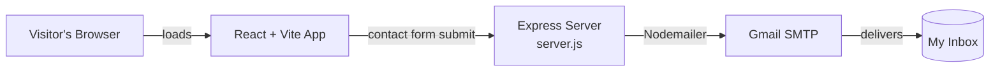

<div align="center">
# 🚀 Portfolio
 
**A fast, animated personal portfolio built with React 19 + Vite, with a working contact form powered by Express & Nodemailer.**
 
[Features](#-features) • [Tech Stack](#-tech-stack) • [Getting Started](#-getting-started) • [Customization](#-customization) • [Deployment](#-deployment) • [Troubleshooting](#-troubleshooting)
 
</div>
---
 
## 📖 About
 
This is the source code of my personal portfolio website, a place to showcase my projects, skills, and background, and to let visitors get in touch. The frontend is a single-page React app bundled with Vite, and a small Node/Express server sends contact-form messages straight to my inbox through Gmail.
 
## ✨ Features
 
- ⚡ **Lightning-fast dev experience:** Vite with instant HMR and optimized production builds
- 🎞️ **Fluid animations:** page and component transitions with Framer Motion, plus Anime.js for custom effects
- 🧈 **Smooth scrolling:** buttery inertia scrolling powered by Lenis
- 🎨 **Crisp icons:** consistent, lightweight icon set from Lucide React
- 📬 **Working contact form:** messages delivered to your Gmail via Nodemailer
- 🔒 **Secrets stay secret:** credentials live in `.env`, never in the codebase
- 🧹 **Fast linting:** Oxlint for near-instant code quality checks
- 📱 **Responsive:** designed to look great on desktop, tablet, and mobile
## 🛠️ Tech Stack
 
| Layer        | Technologies                                      |
| ------------ | ------------------------------------------------- |
| **Frontend** | React 19, Vite, Framer Motion, Anime.js, Lenis    |
| **UI**       | Lucide React                                      |
| **Backend**  | Node.js, Express 5, Nodemailer, dotenv            |
| **Tooling**  | Oxlint, npm                                       |
 
## 🏗️ How It Works
 

 
## 📂 Project Structure
 
```
Portfolio/
├── public/            # Static assets (images, icons, favicon)
├── src/               # React components, styles, and app logic
├── .env.example       # Template for required environment variables
├── .gitignore
├── .oxlintrc.json     # Oxlint rules
├── index.html         # App entry HTML
├── server.js          # Express server for the contact form
├── vite.config.js     # Vite configuration
└── package.json
```
 
## 🚦 Getting Started
 
### Prerequisites
 
| Requirement | Notes |
| ----------- | ----- |
| [Node.js](https://nodejs.org/) | v20.19+ recommended (required by recent Vite versions) |
| npm | Bundled with Node.js |
| Gmail account | With 2-Step Verification enabled, so you can create an [App Password](https://myaccount.google.com/apppasswords) |
 
### Installation
 
```bash
# 1. Clone the repository
git clone https://github.com/KDurgaPrasad116/Portfolio.git
cd Portfolio
 
# 2. Install dependencies
npm install
 
# 3. Create your environment file
cp .env.example .env
```
 
Open `.env` and add your credentials (see [Environment Variables](#-environment-variables)).
 
### Run Locally
 
The frontend and backend run as two separate processes, so use **two terminals**:
 
```bash
# Terminal 1: frontend (Vite dev server)
npm run dev
 
# Terminal 2: backend (Express contact-form server)
npm run server
```
 
Then open the URL Vite prints, usually **http://localhost:5173** 🎉
 
> 💡 Only working on the UI? You can skip the backend. Everything except the contact form will work with just `npm run dev`.
 
## 🔐 Environment Variables
 
Create a `.env` file in the project root:
 
```env
GMAIL_USER=your_email@gmail.com
GMAIL_APP_PASSWORD=your_16_character_app_password
PORT=5000
```
 
| Variable             | Required | Description                                              |
| -------------------- | :------: | -------------------------------------------------------- |
| `GMAIL_USER`         |    ✅    | Gmail address used to send and receive contact messages  |
| `GMAIL_APP_PASSWORD` |    ✅    | 16-character Google App Password (**not** your login password) |
| `PORT`               |    ➖    | Port for the Express server (defaults to `5000`)         |
 
<details>
<summary><b>How do I get a Gmail App Password?</b></summary>
1. Turn on **2-Step Verification** in your [Google Account](https://myaccount.google.com/security).
2. Go to [App Passwords](https://myaccount.google.com/apppasswords).
3. Create a new app password (name it e.g. "Portfolio").
4. Copy the 16-character code into `GMAIL_APP_PASSWORD` in your `.env` (spaces can be removed).
</details>
> ⚠️ **Never commit your `.env` file.** It's already listed in `.gitignore`. If you ever push credentials by accident, revoke the App Password immediately.
 
## 📜 Available Scripts
 
| Command           | What it does                                   |
| ----------------- | ---------------------------------------------- |
| `npm run dev`     | Starts the Vite dev server with hot reload     |
| `npm run server`  | Starts the Express backend (`server.js`)       |
| `npm run build`   | Builds the optimized production bundle to `dist/` |
| `npm run preview` | Serves the production build locally            |
| `npm run lint`    | Lints the project with Oxlint                  |
 
## 🎨 Customization
 
Make the portfolio yours in a few steps:
 
1. **Content:** edit the components in `src/` to update your name, bio, skills, projects, and links.
2. **Assets:** drop your images, resume, and favicon into `public/`.
3. **Page title & meta tags:** update `index.html` for SEO and social previews.
4. **Contact email:** set `GMAIL_USER` in `.env` to the inbox where you want to receive messages.
5. **Animations:** tune Framer Motion variants or Lenis scroll settings to change the feel.
## 🌐 Deployment
 
This project has two parts, so deploy each one separately.
 
**Frontend (static)**
 
```bash
npm run build
```
 
Deploy the generated `dist/` folder to **Vercel**, **Netlify**, **Cloudflare Pages**, or **GitHub Pages**.
 
**Backend (Node)**
 
Deploy `server.js` to a Node host such as **Render**, **Railway**, or **Fly.io**, then:
 
- Set `GMAIL_USER`, `GMAIL_APP_PASSWORD`, and `PORT` in the host's environment settings
- Start command: `npm run server`
- Point the frontend's contact-form request at your deployed backend URL
## 🧰 Troubleshooting
 
<details>
<summary><b>Contact form isn't sending emails</b></summary>
- Confirm the backend is running (`npm run server`) and listening on the expected `PORT`.
- Double-check `GMAIL_USER` and `GMAIL_APP_PASSWORD` in `.env`, and restart the server after editing it.
- Make sure you used an **App Password**, not your regular Gmail password.
- Check the server terminal for error messages from Nodemailer.
</details>
<details>
<summary><b><code>npm install</code> or <code>npm run dev</code> fails</b></summary>
- Check your Node version with `node -v` and upgrade if it's too old.
- Delete `node_modules` and `package-lock.json`, then run `npm install` again.
</details>
<details>
<summary><b>Port already in use</b></summary>
Change `PORT` in `.env` (backend), or stop the process using that port.
 
</details>
## 🤝 Contributing
 
Suggestions and improvements are welcome!
 
1. Fork the repository
2. Create a branch: `git checkout -b feature/amazing-idea`
3. Commit your changes: `git commit -m "Add amazing idea"`
4. Push to the branch: `git push origin feature/amazing-idea`
5. Open a Pull Request
## 📄 License
 
<!-- Add a LICENSE file (e.g. MIT) and update this section. -->
This project is open for learning and inspiration. If you reuse it, please give credit.
 
## 📫 Connect With Me
 
**K. Durga Prasad**
 
- GitHub: [@KDurgaPrasad116](https://github.com/KDurgaPrasad116)
---
 
<div align="center">
⭐ **If you found this useful, consider giving it a star!** ⭐
 
</div>
 
